[](https://archont561.github.io/)

<div align="center">

[](https://archont561.github.io/)
[](https://archont561.github.io/docs/)
[](https://archont561.github.io/packages/)
[](https://github.com/Archont561?tab=repositories)
[](https://archont561.github.io/llms.txt)

</div>

## `> ls --principles`

- **lock** — same lockfile, same result (Pixi + Conda lockfiles, SHA-pinned actions)
- **test** — test behaviour, not lines (Gherkin specs, property tests, a 90% floor)
- **document** — docs ship with the code (llms.txt and .md routes for agents)
- **ship** — small commits, green gate first (conventional commits, no force-push)
- **enforce** — if a machine can check it, it does (ast-grep, Alint, Vale, commitlint)


I build open-source tools that make geospatial and scientific software reproducible,
and I care most about the unglamorous part: the lockfile, the test harness, the CI gate,
the review comment. Everything here is a public fact about the code — this profile
publishes no name, location, employer, availability, or proficiency score.

```toml
# pixi.toml — reproducible environment definition
[workspace]
name = "archont561"
channels = ["conda-forge", "archont561"]

[package]
role = "Student · open-source contributor"
focus = ["Geospatial systems", "Reproducible environments", "Testing infrastructure", "Repo management"]
principle = "Lock it, test it, document it, then ship it."
review-style = "Reproducible or it did not happen."
```

## `> ls --infrastructure` — shipped and maintained

Each card opens the project's page in the [portfolio](https://archont561.github.io/); the last one
lists every repository. Stack and registry chips come from the captured snapshot.

<p align="center">
  <a href="https://archont561.github.io/docs/projects/qgis-sdk/"></a>
  <a href="https://archont561.github.io/docs/projects/qgis-agent-harness/"></a>
</p>

<p align="center">
  <sub><code>qgis-sdk</code>: <a href="https://github.com/Archont561/qgis-sdk">repo</a> · <a href="https://archont561.github.io/docs/projects/qgis-sdk/">docs</a> &nbsp;|&nbsp; <code>qgis-agent-harness</code>: <a href="https://github.com/Archont561/qgis-agent-harness">repo</a> · <a href="https://archont561.github.io/docs/projects/qgis-agent-harness/">docs</a></sub>
</p>

<p align="center">
  <a href="https://archont561.github.io/docs/projects/pixi-sandbox/"></a>
  <a href="https://archont561.github.io/docs/projects/bun-test-utils/"></a>
</p>

<p align="center">
  <sub><code>pixi-sandbox</code>: <a href="https://github.com/Archont561/pixi-sandbox">repo</a> · <a href="https://archont561.github.io/docs/projects/pixi-sandbox/">docs</a> &nbsp;|&nbsp; <code>bun-test-utils</code>: <a href="https://github.com/Archont561/bun-test-utils">repo</a> · <a href="https://archont561.github.io/docs/projects/bun-test-utils/">docs</a></sub>
</p>

<p align="center">
  <a href="https://archont561.github.io/docs/projects/playtest/"></a>
  <a href="https://archont561.github.io/docs/"></a>
</p>

<p align="center">
  <sub><code>playtest</code>: <a href="https://github.com/Archont561/playtest">repo</a> · <a href="https://archont561.github.io/docs/projects/playtest/">docs</a> &nbsp;|&nbsp; <code>all-projects</code>: <a href="https://github.com/Archont561/archont561.github.io">repo</a> · <a href="https://archont561.github.io/docs/">docs</a></sub>
</p>

## `> cat contribution.log`

```diff
+ [ACTIVE] 🗺️ Packaging: cross-platform Conda recipes for geospatial pipelines.
+ [ACTIVE] 🧪 Testing: typed fixtures and BDD harnesses for Bun and pytest.
+ [ACTIVE] 📚 Docs: agent-readable exports (llms.txt and `.md` routes) on the portfolio.
+ [OPEN] 📦 Upstreaming: geospatial recipes toward conda-forge, one PR at a time.
+ [OPEN] 🧹 Hygiene: keep every repository titled, licensed, and CI-gated.
- [DONE] 📐 Split repository-scoped detail out of this profile README.
   [WONT] Résumé claims, availability statements, or animated stat widgets.
```

| Ecosystem | Namespace | Released |
| :--- | :--- | :---: |
| **npm** | `@archont561` | 4 |
| **PyPI** | `Archont561` | 5 |
| **crates.io** | `Archont561` | 2 |
| **Conda** | `archont561/archont561` | 12 |


## `> man archont561` — FAQ

<details name="faq">
<summary><b>📚 Which other projects are there?</b></summary>

Every project, with its source repository; each name opens its page in the portfolio.

| Project | What it is | Source |
| --- | --- | --- |
| [qgis-sdk](https://archont561.github.io/docs/projects/qgis-sdk/) | Python-first SDK and TypeScript bridge for typed, testable QGIS 4 plugins. | [GitHub](https://github.com/Archont561/qgis-sdk) |
| [qgis-agent-harness](https://archont561.github.io/docs/projects/qgis-agent-harness/) | Harness for evaluating GIS-agent artefacts with a shared QGIS runtime and oracle. | [GitHub](https://github.com/Archont561/qgis-agent-harness) |
| [pixi-sandbox](https://archont561.github.io/docs/projects/pixi-sandbox/) | Cloneable, verifiable environment packs for Pixi projects. | [GitHub](https://github.com/Archont561/pixi-sandbox) |
| [bun-test-utils](https://archont561.github.io/docs/projects/bun-test-utils/) | Typed fixtures and test extensions for the Bun test runner. | [GitHub](https://github.com/Archont561/bun-test-utils) |
| [playtest](https://archont561.github.io/docs/projects/playtest/) | Playwright-style testing for Rust. | [GitHub](https://github.com/Archont561/playtest) |
| [universe](https://archont561.github.io/docs/projects/universe/) | Rust toolkit for self-hosted universes of software, data, models, and skills. | [GitHub](https://github.com/Archont561/universe) |
| [PyShellForge](https://archont561.github.io/docs/projects/pyshellforge/) | Python DSL and AST-based compiler that emits clean, readable shell scripts. | [GitHub](https://github.com/Archont561/PyShellForge) |
| [ODM-conda](https://archont561.github.io/docs/projects/odm-conda/) | Modular, Pixi-managed conda packaging for OpenDroneMap components. | [GitHub](https://github.com/Archont561/ODM-conda) |
| [CloudCompare-conda](https://archont561.github.io/docs/projects/cloudcompare-conda/) | Cross-platform Conda packaging for point-cloud and mesh processing. | [GitHub](https://github.com/Archont561/CloudCompare-conda) |

</details>

<details name="faq">
<summary><b>📦 Where are the packages published?</b></summary>

Packages are discovered from each account rather than listed by hand: the npm org, the
PyPI and crates.io users, the NuGet owner, the Maven Central namespace, the R-universe
registry, and the prefix.dev channels. Reserved names are counted apart from releases, and
a `0.0.0` stub or a registered but unbuilt package is never presented as a published package.

<!-- registry:start -->
```text
npm            @archont561             published 4   (reserved names: 5)
PyPI           Archont561              published 5   (reserved names: 4)
crates.io      Archont561              published 2   (reserved names: 6)
NuGet          Archont561              published 0   (reserved names: 1)
Maven Central  io.github.archont561    published 0   (reserved names: 1)
R-universe     archont561              published 0   (reserved names: 1)
Conda          archont561/archont561   packages 12
Conda          archont561/geospatial   packages 0
latest         universe 0.1.0 · Conda · 2026-11-11
source         npm, PyPI, crates.io, NuGet, Maven Central, R-universe, and prefix.dev APIs, captured 2026-11-11
```
<!-- registry:end -->

[](https://www.npmjs.com/org/archont561)
[](https://pypi.org/user/Archont561/)
[](https://crates.io/users/Archont561)
[](https://www.nuget.org/profiles/Archont561)
[](https://central.sonatype.com/namespace/io.github.archont561)
[](https://github.com/Archont561/archont561.r-universe.dev)
[](https://prefix.dev/channels/@archont561/archont561)
[](https://prefix.dev/channels/@archont561/geospatial)

Conda channels install from `https://prefix.dev/archont561/archont561` and `https://prefix.dev/archont561/geospatial`.

The [packages page](https://archont561.github.io/packages/) of the portfolio goes deeper:
versions, licences, platforms, and install commands.

</details>

<details name="faq">
<summary><b>🧭 What does “maintained” mean here?</b></summary>

Counts are captured from the GitHub REST API by `bun run tools capture`, so they are refreshed
rather than hand-tuned. No badge service is involved.

<!-- repo-hygiene:start -->
```text
public repositories   23  (authored: 23, forks: 0, archived: 2)
topic metadata        20/23 repositories
primary languages     Python 14 · Rust 3 · TypeScript 2 · Astro 1
source                GitHub REST, captured 2026-11-11
```
<!-- repo-hygiene:end -->

Archived repositories stay visible on purpose: retiring work cleanly is part of
maintaining it.

</details>

<details name="faq">
<summary><b>🧰 Which toolchain is behind all this?</b></summary>

- 🔒 **Reproducibility** — Pixi and Conda lockfiles · conda-forge style recipes · SHA-pinned GitHub Actions
- 🧪 **Testing** — pytest-bdd and Gherkin specs in every repository · typed Bun test extensions
- 🗺️ **Geospatial** — QGIS runtime and SDK tooling · point-cloud and ODM packaging
- 🧭 **Repo management** — dependency automation, link and structure gates, deliberate archives
- 📝 **Docs as code** — Fumadocs with `llms.txt` and parallel `.md` routes for agents
- 🤝 **Contribution** — issue-first, changelog-per-release, no push without a green gate

</details>

<details name="faq">
<summary><b>🩺 How healthy is this profile repo?</b></summary>

[](https://github.com/Archont561/Archont561/actions/workflows/ci.yml)
[](https://codecov.io/gh/Archont561/Archont561)
[](https://github.com/Archont561/Archont561/actions/workflows/refresh.yml)

[](https://github.com/Archont561/Archont561/blob/main/codecov.yml)
[](https://github.com/Archont561/Archont561/blob/main/docs/concepts/rule-register.md)
[](https://github.com/Archont561/Archont561/blob/main/biome.json)
[](https://github.com/Archont561/Archont561/blob/main/.commitlintrc.json)
[](https://github.com/Archont561/Archont561/blob/main/lefthook.yml)
[](https://github.com/Archont561/Archont561/blob/main/package.json)
[](https://github.com/Archont561/Archont561/blob/main/LICENSE)

Every check runs through `bun run tools <cmd>` (citty commands discovered from `tools/commands/`), so
lefthook, CI, and a local shell run the same code:

```text
lint        Biome · tsc · ast-grep · Alint · Vale    polyglot-clean-code v0.1.0 pedantic presets
            knip · dependency-cruiser · secretlint   unused code, import layering, leaked secrets
            actionlint · zizmor                      valid, injection-free workflows
links       lychee                                   repo links and anchors on every push; every link daily
test        bun-test-utils scenarios                 fails under 90% lines or functions; Codecov gates PRs
readme      --check                                  README.md and assets/ must match their sources
commitlint  Conventional Commits                     commit-msg hook, every pull request and its title
refresh     daily at 04:17 UTC                       captures registries and commits only on drift
```

Bun, actionlint, zizmor and lychee come from `pixi.lock`; everything else from `bun.lock`.

</details>

<details name="faq">
<summary><b>🛠️ How is this README made?</b></summary>

The terminal framing borrows from a free GitSkins community template by
[@Avijit010325](https://github.com/Avijit010325)
([community templates](https://www.gitskins.com/community-templates)); all text, links,
and claims were rewritten to public repository facts. The portal, project and principles cards are hand-drawn
animated SVGs, the footer banner is [figlet](https://www.npmjs.com/package/figlet) art, and
the badges are rendered offline by [badge-maker](https://www.npmjs.com/package/badge-maker);
all of them are committed under `assets/`, so only the three live status badges call a service.
GitHub serves them as images, which cannot react to hover or know they scrolled into view,
so the spotlight tours the project cards on its own and the terminal replays its command.
`bun run tools capture` records live GitHub and registry facts in `data/snapshot.json` through
clients generated from each registry's OpenAPI or GraphQL schema, and
`bun run tools readme` renders `templates/profile.ejs` with them and `data/profile.json`.
Edit those, never this file. The portfolio itself lives in
[Archont561/archont561.github.io](https://github.com/Archont561/archont561.github.io).

</details>

<details name="faq">
<summary><b>📮 How do I get in touch?</b></summary>

No contact channel is published here. The entry point for every project is an issue in
its repository, and contributions that arrive with a failing test and a lockfile update
are the kind most likely to be merged quickly.

</details>

---

<div align="center">

[](https://archont561.github.io/)
[](https://archont561.github.io/packages/)
[](https://github.com/Archont561)
[](https://github.com/Archont561?tab=repositories)

</div>
